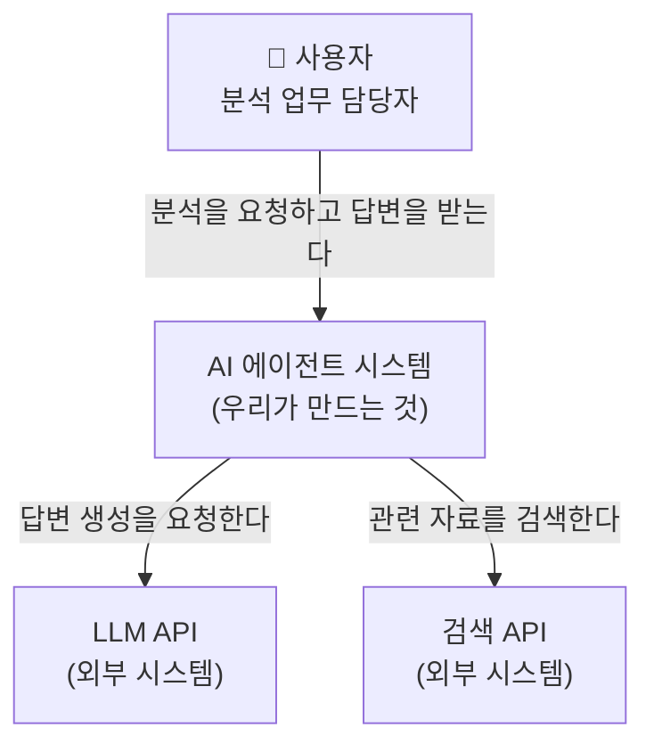
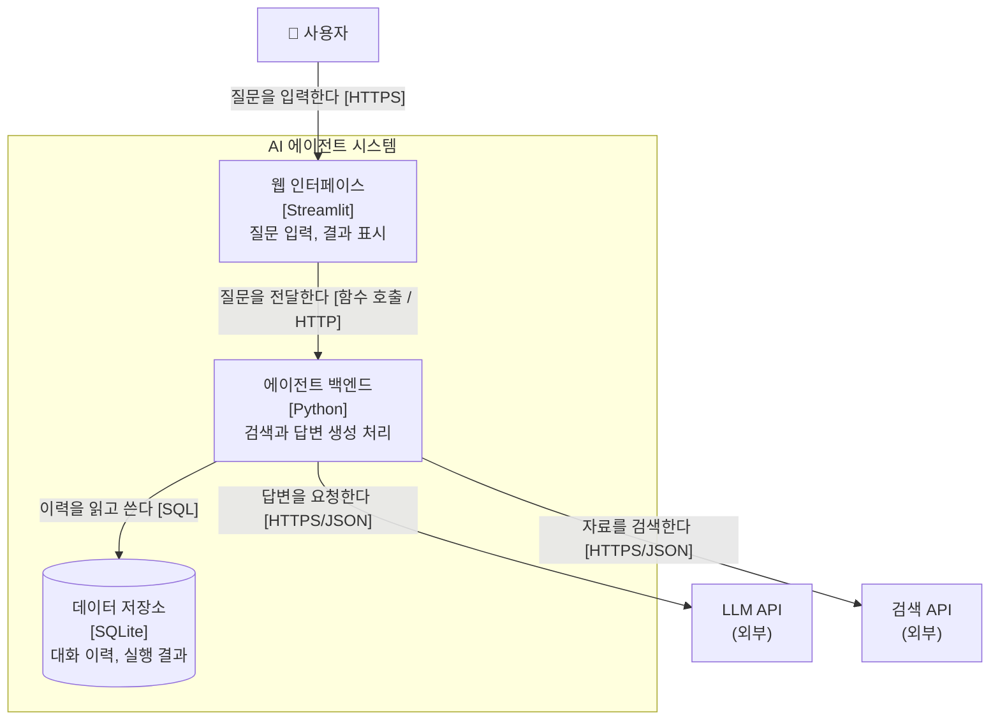
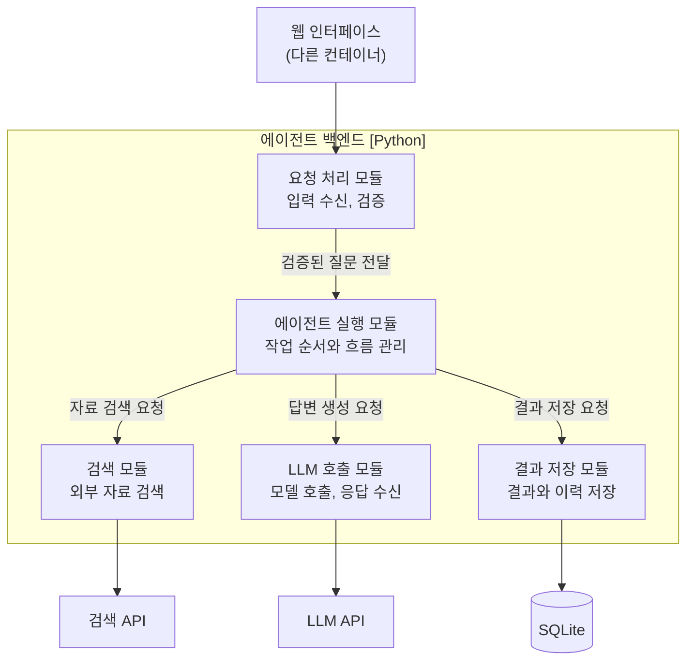
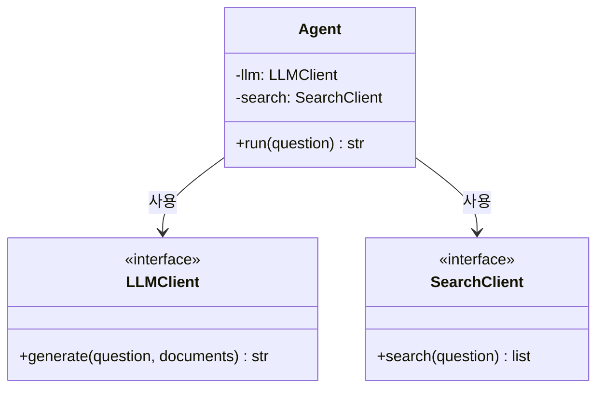
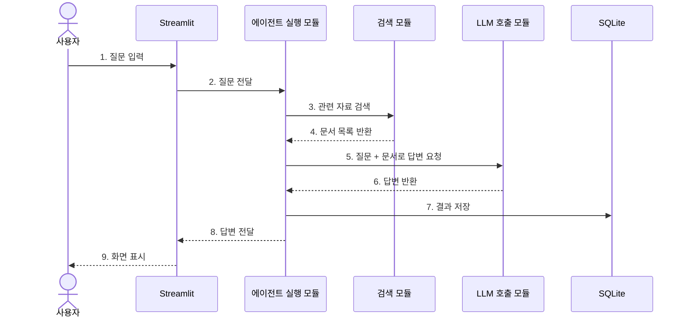

# C4 모델 쉽게 이해하기

AI 에이전트 시스템을 예시로, C4 모델을 처음 보는 사람도 따라올 수 있게 풀어 쓴 정리입니다.

---

## 0. 한 줄 요약

C4 모델은 소프트웨어 구조를 **지도 앱처럼 확대해 가며** 보여주는 방법입니다.
나라 전체를 보다가 도시, 동네, 건물 내부 순서로 줌인하듯이, 시스템도 바깥에서 안쪽으로 네 단계에 걸쳐 들여다봅니다.

| 지도 비유 | C4 단계 | 무엇을 보나 |
|---|---|---|
| 나라 지도 | C1 Context | 우리 시스템과 바깥 세상(사용자, 외부 서비스)의 관계 |
| 도시 지도 | C2 Container | 시스템을 이루는 실행 단위(웹 앱, 백엔드, DB) |
| 동네 지도 | C3 Component | 한 실행 단위 안의 기능 덩어리(모듈) |
| 건물 설계도 | C4 Code | 모듈 안의 클래스, 함수 |

이름의 C4는 네 단계의 첫 글자 Context, Container, Component, Code에서 왔습니다. 영국의 소프트웨어 아키텍트 Simon Brown이 만들었습니다.

---

## 1. 왜 이런 방법이 필요할까

아키텍처 그림을 그려 본 적이 있다면 이런 경험이 한 번쯤 있을 거예요.

- 박스와 화살표를 잔뜩 그렸는데, 박스가 서버인지 모듈인지 클래스인지 섞여 있다.
- 화살표가 "호출"인지 "데이터 흐름"인지 "의존"인지 알 수 없다.
- 기획자에게 보여주기엔 너무 자세하고, 개발자에게 주기엔 너무 막연하다.

C4 모델은 이 문제를 **"한 장의 그림에는 한 가지 확대 수준만 담는다"** 는 규칙으로 해결합니다.
그래서 듣는 사람에 맞춰 알맞은 단계의 그림을 꺼내 보여줄 수 있습니다.

| 그림 | 주로 보는 사람 |
|---|---|
| C1 | 경영진, 기획자, 고객, 처음 합류한 팀원 등 비개발자 포함 모두 |
| C2 | 개발자, 인프라/운영 담당자, 보안 담당자 |
| C3 | 해당 애플리케이션을 개발하는 개발자 |
| C4 | 해당 모듈을 직접 고치는 개발자 |

중요한 점 하나. C4 모델은 **특정 기술이나 그림 도구를 강요하지 않습니다.** 화이트보드에 손으로 그려도 되고, 어떤 도구를 써도 됩니다. 규칙은 "무엇을 어느 수준으로 그릴지"에 관한 것입니다.

---

## 2. C4에 등장하는 기본 요소

네 단계를 보기 전에 등장인물부터 정리해 두면 훨씬 쉽습니다.

| 요소 | 뜻 | 예시 |
|---|---|---|
| Person (사람) | 시스템을 사용하는 사람이나 역할 | 분석가, 관리자, 고객 |
| Software System (소프트웨어 시스템) | 가치를 제공하는 소프트웨어 전체 덩어리. 우리 것일 수도, 외부 것일 수도 있음 | AI 에이전트 시스템, OpenAI API, 검색 API |
| Container (컨테이너) | 시스템 안에서 따로 실행되거나 배포되는 단위 | Streamlit 웹 앱, Python 백엔드, SQLite, 벡터 DB |
| Component (컴포넌트) | 하나의 컨테이너 안에서 역할별로 묶인 기능 덩어리 | 요청 처리 모듈, 검색 모듈, LLM 호출 모듈 |
| Code (코드) | 컴포넌트를 구현하는 클래스, 인터페이스, 함수 | `Agent` 클래스, `run()` 메서드 |
| Relationship (관계) | 요소 사이의 화살표. **무엇을 하는지 + 어떤 방식으로** 를 글로 적음 | "질문을 보낸다 [HTTPS/JSON]" |

포함 관계로 보면 이렇게 됩니다.

```
소프트웨어 시스템
 └─ 컨테이너 (여러 개)
     └─ 컴포넌트 (여러 개)
         └─ 코드 (클래스, 함수)
```

### 헷갈리기 쉬운 "컨테이너"

C4의 Container는 **Docker 컨테이너가 아닙니다.** 이름이 겹쳐서 가장 많이 오해받는 부분이에요.
C4에서 말하는 컨테이너는 "독립적으로 실행되는 무언가"입니다.

판별법: **"이걸 따로 켜고 끌 수 있나? 따로 배포하나? 데이터를 따로 보관하나?"** 셋 중 하나라도 "예"라면 컨테이너 후보입니다.

- 컨테이너 O: 웹 앱, 모바일 앱, API 서버, 배치 스크립트, 데이터베이스, 파일 저장소, 메시지 큐
- 컨테이너 X: Python 패키지 하나, 클래스, 라이브러리(이것들은 컴포넌트나 코드 수준)

Docker는 오히려 뒤에서 다룰 **배포 다이어그램**에 등장하는 것이 자연스럽습니다. 컨테이너 하나를 Docker 컨테이너에 담아 배포할 수도 있고, 그냥 서버에 직접 설치할 수도 있으니까요.

---

## 3. 단계별로 자세히 보기

예시 시스템: 사용자가 질문하면 외부 자료를 검색하고 LLM으로 답변을 만들어 주는 **AI 에이전트 시스템**

### 3.1 C1: Context (시스템 맥락도)

**핵심 질문: 누가 쓰고, 무엇과 연결되는가?**

우리 시스템을 **박스 하나**로 그리고, 그 주변의 사람과 외부 시스템만 그립니다. 내부 구조는 일부러 감춥니다.



이 그림 하나로 알 수 있는 것:

- 이 시스템을 쓰는 사람은 누구인가
- 우리가 책임지는 범위는 어디까지인가(가운데 박스)
- 우리가 통제할 수 없는 외부 의존성은 무엇인가(LLM API, 검색 API)

실무 팁: C1은 보안 검토나 비용 논의에서 특히 유용합니다. "데이터가 외부로 나가는 지점"이 화살표로 바로 보이기 때문이에요.

---

### 3.2 C2: Container (컨테이너 다이어그램)

**핵심 질문: 시스템은 어떤 실행 단위로 이루어져 있는가?**

C1의 가운데 박스를 열어서 안을 보여주는 단계입니다. 각 컨테이너에는 **사용 기술**을 함께 적는 것이 관례입니다.



원본 PDF 그림을 보완한 부분:

- PDF 본문에는 "외부 LLM API 등으로 구성할 수 있음"이라고 되어 있지만, 엄밀히는 **LLM API는 우리 시스템의 컨테이너가 아니라 바깥의 외부 시스템**입니다. 그래서 위 그림에서는 시스템 경계(테두리) 밖에 두었습니다.
- 화살표마다 통신 방식([HTTPS], [SQL] 등)을 적었습니다. C2에서는 이 정보가 인프라·보안 담당자에게 가장 쓸모 있는 부분입니다.

이 그림으로 알 수 있는 것:

- 무엇을 배포하고 운영해야 하는가(웹, 백엔드, DB 세 개)
- 데이터는 어디에 저장되는가
- 장애가 나면 어느 부분부터 의심해야 하는가

---

### 3.3 C3: Component (컴포넌트 다이어그램)

**핵심 질문: 컨테이너 하나는 내부적으로 어떤 기능으로 나뉘는가?**

C2에서 컨테이너 **하나**를 골라 안을 엽니다. 보통 로직이 가장 복잡한 백엔드를 고릅니다.



| 컴포넌트 | 하는 일 | 바뀌면 영향받는 곳 |
|---|---|---|
| 요청 처리 모듈 | 사용자 입력을 받아 형식과 길이 등을 검증 | 입력 규칙이 바뀔 때 |
| 에이전트 실행 모듈 | 검색 → 생성 → 저장 순서를 지휘하는 지휘자 역할 | 작업 흐름이 바뀔 때 |
| 검색 모듈 | 외부 검색 API나 문서 저장소에서 자료 수집 | 검색 엔진을 교체할 때 |
| LLM 호출 모듈 | 프롬프트 구성, 모델 호출, 응답 파싱 | 모델 제공사를 바꿀 때 |
| 결과 저장 모듈 | 실행 결과와 이력 기록 | DB를 바꿀 때 |

C3의 진짜 가치는 마지막 열에 있습니다. **"LLM 제공사를 바꾸면 LLM 호출 모듈만 고치면 된다"** 처럼 변경의 영향 범위가 눈에 보이게 됩니다. 반대로 그림을 그렸는데 화살표가 거미줄처럼 얽혀 있다면, 모듈 간 책임 분리가 덜 되었다는 신호이기도 해요.

원본 PDF 그림을 보완한 부분: PDF 그림에서는 결과 저장 모듈로 들어가는 화살표가 빠져 있어서 누가 호출하는지 보이지 않습니다. 위 그림에서는 에이전트 실행 모듈이 호출하도록 연결했습니다.

---

### 3.4 C4: Code (코드 다이어그램)

**핵심 질문: 그 기능은 코드로 어떻게 구현되어 있는가?**

컴포넌트 하나를 골라 클래스와 메서드 수준으로 보여줍니다. 보통 UML 클래스 다이어그램을 씁니다.

```python
class Agent:
    def __init__(self, llm, search):
        self.llm = llm          # LLM 호출 모듈 객체
        self.search = search    # 검색 모듈 객체

    def run(self, question):
        documents = self.search.search(question)          # 1) 자료 검색
        answer = self.llm.generate(question, documents)   # 2) 답변 생성
        return answer
```



이 코드에서 눈여겨볼 설계 포인트:

- `Agent`는 `llm`과 `search`를 **직접 만들지 않고 바깥에서 전달받습니다.** 이를 의존성 주입이라고 부릅니다.
- 덕분에 테스트할 때 가짜 LLM 객체를 넣을 수 있고, 모델 제공사를 바꿔도 `Agent` 코드는 그대로 둘 수 있습니다.
- C3에서 본 "모듈 간 관계"가 코드에서는 바로 이 `self.llm`, `self.search` 참조로 나타나는 것입니다.

C4 단계에 대한 현실적인 조언: **이 단계는 대부분 그리지 않아도 됩니다.** 코드는 자주 바뀌어서 그림이 금방 낡고, IDE가 클래스 구조를 자동으로 보여주기도 하니까요. 공식 가이드에서도 정말 중요하거나 복잡한 부분에만 쓰라고 권합니다.

---

## 4. 네 단계 한눈에 비교

| 구분 | C1 Context | C2 Container | C3 Component | C4 Code |
|---|---|---|---|---|
| 확대 수준 | 가장 멀리 | 시스템 내부 | 컨테이너 내부 | 컴포넌트 내부 |
| 박스 하나의 의미 | 시스템 전체 | 실행·배포 단위 | 기능 모듈 | 클래스, 함수 |
| AI 에이전트 예시 | 사용자, 에이전트, LLM API, 검색 API | Streamlit, Python 백엔드, SQLite | 요청 처리, 실행, 검색, LLM 호출, 저장 | `Agent`, `run()` |
| 기술 이름 표기 | 보통 생략 | 반드시 적음 | 적으면 좋음 | 코드 그대로 |
| 그릴 필요성 | 거의 항상 | 거의 항상 | 복잡한 컨테이너만 | 드물게 |
| 그림이 낡는 속도 | 매우 느림 | 느림 | 보통 | 매우 빠름 |

실무에서 가장 자주, 가장 오래 쓰이는 것은 **C1과 C2** 입니다. 두 장만 잘 그려도 프로젝트 설명의 80%는 해결됩니다.

---

## 5. 네 단계 외에 함께 쓰는 보조 다이어그램

C4 모델은 네 단계의 "정적인 구조" 외에, 필요할 때 덧붙이는 그림도 제안합니다.

### 5.1 동적 다이어그램: "어떤 순서로 움직이나?"

구조 그림은 "무엇이 있는지"는 보여주지만 "어떤 순서로 실행되는지"는 잘 보여주지 못합니다. 이럴 때 순서 번호를 붙인 그림이나 시퀀스 다이어그램을 씁니다.



AI 에이전트처럼 "검색 후 생성", "도구 호출 반복" 같은 흐름이 핵심인 시스템에서는 이 그림이 C3보다 더 설명력이 좋을 때도 많습니다.

### 5.2 배포 다이어그램: "어디에 올라가 있나?"

C2의 컨테이너들이 실제로 어떤 서버, 어떤 Docker 컨테이너, 어떤 클라우드에 올라가는지를 보여줍니다.

```
[클라우드 VM (Ubuntu)]
 ├─ Docker 컨테이너: streamlit-app   ← 웹 인터페이스
 ├─ Docker 컨테이너: agent-backend   ← 에이전트 백엔드
 └─ 볼륨: /data/app.db               ← SQLite 파일
```

앞에서 말한 "C4의 컨테이너 ≠ Docker"가 여기서 정리됩니다. **C2는 논리적 구성, 배포 다이어그램은 물리적 배치** 입니다.

### 5.3 시스템 랜드스케이프: "회사 전체에서 우리는 어디쯤?"

조직 안에 여러 시스템이 있을 때, C1보다 한 단계 더 멀리서 시스템들 사이의 관계를 보여주는 그림입니다.

---

## 6. 좋은 C4 그림을 그리는 규칙

공식 가이드에서 권하는 표기 원칙을 정리하면 이렇습니다.

1. **모든 그림에 제목을 붙인다.** "C2 - AI 에이전트 시스템 컨테이너 다이어그램"처럼 단계와 대상을 적습니다.
2. **박스마다 이름, 종류, 기술, 한 줄 설명을 적는다.**
   예: `에이전트 백엔드` / `Container` / `Python` / `검색과 답변 생성을 처리함`
3. **화살표는 한 방향으로, 반드시 글을 붙인다.** "사용"처럼 막연한 말 대신 "질문을 전달한다"처럼 구체적으로 씁니다. C2부터는 [HTTPS], [SQL] 같은 통신 방식도 함께 적습니다.
4. **범례를 둔다.** 색이나 모양에 의미를 줬다면 무슨 뜻인지 밝힙니다.
5. **약어는 풀어 쓰거나 설명한다.** 처음 보는 사람이 그림만으로 이해할 수 있어야 합니다.
6. **한 그림에 한 수준만.** 컨테이너 그림에 클래스를 섞지 않습니다.

스스로 점검하는 질문: **"이 그림을 설명 없이 동료에게 보내도 이해할까?"** 그렇다면 잘 그린 그림입니다.

---

## 7. 자주 하는 실수

| 실수 | 왜 문제인가 | 이렇게 고친다 |
|---|---|---|
| Container를 Docker 컨테이너로 이해 | 논리 구조와 배포 구조가 뒤섞임 | 실행 단위는 C2, Docker는 배포 다이어그램 |
| 외부 API를 시스템 내부에 그림 | 우리가 통제하는 범위가 흐려짐 | 시스템 경계 밖에 외부 시스템으로 표시 |
| 라이브러리(예: LangChain)를 컨테이너로 그림 | 라이브러리는 따로 실행되지 않음 | 컴포넌트의 기술 표기로 적거나 생략 |
| 화살표에 설명이 없음 | 호출인지, 데이터 흐름인지 알 수 없음 | "무엇을 + 어떻게" 글로 적기 |
| 모든 컨테이너마다 C3, C4를 다 그림 | 관리 부담만 크고 금방 낡음 | 복잡하거나 중요한 곳만 상세화 |
| 그림과 실제 코드가 어긋남 | 문서를 믿을 수 없게 됨 | 코드로 그림을 관리하는 도구 활용(아래 참고) |

---

## 8. C4 모델과 UML은 무엇이 다를까

| 구분 | C4 모델 | UML |
|---|---|---|
| 성격 | 아키텍처를 **어느 수준으로** 설명할지에 대한 접근법 | 다이어그램을 **어떻게 그릴지**에 대한 표준 표기법 |
| 다이어그램 종류 | 4단계 + 보조 다이어그램 몇 가지 | 클래스, 시퀀스, 활동, 상태 등 10여 종 |
| 표기 규칙 | 느슨함(박스와 글만 있으면 됨) | 엄격함(기호마다 정해진 의미) |
| 배우는 부담 | 낮음 | 상대적으로 높음 |
| 강점 | 큰 그림 소통, 비개발자 설명 | 세부 설계, 정밀한 동작 표현 |

둘은 경쟁 관계가 아니라 **함께 쓰는 관계** 입니다. 실제로 위 문서에서도 C4 단계에는 UML 클래스 다이어그램을, 동적 다이어그램에는 UML 시퀀스 다이어그램을 사용했습니다.
큰 지도는 C4로 그리고, 확대한 세부 도면이 필요한 곳에는 UML을 쓴다고 생각하면 편합니다.

---

## 9. 그림을 그리는 도구

| 방식 | 도구 | 특징 |
|---|---|---|
| 손그림·드래그 | 화이트보드, draw.io, Excalidraw | 가장 빠르게 시작, 대신 일관성 관리는 수동 |
| 코드로 그림 | Mermaid | GitHub README에서 바로 렌더링됨. 이 문서의 그림도 Mermaid |
| 코드로 그림 | PlantUML + C4-PlantUML | C4 전용 문법(`Person`, `Container`, `Rel`) 제공 |
| 모델 기반 | Structurizr | C4 창시자가 만든 도구. 모델 하나로 여러 단계 그림을 자동 생성 |

GitHub 포트폴리오에 아키텍처를 올린다면 **Mermaid가 가장 간편합니다.** README에 코드 블록만 넣으면 그림으로 보이고, 코드와 함께 버전 관리가 되니까요.

예시로, Mermaid의 C4 전용 문법은 이렇게 생겼습니다.

```
C4Context
    title C1 - AI 에이전트 시스템 맥락도
    Person(user, "사용자", "분석 업무 담당자")
    System(agent, "AI 에이전트 시스템", "검색 기반 답변 생성")
    System_Ext(llm, "LLM API", "외부 언어 모델")
    System_Ext(search, "검색 API", "외부 검색 서비스")
    Rel(user, agent, "분석을 요청한다")
    Rel(agent, llm, "답변 생성을 요청한다", "HTTPS")
    Rel(agent, search, "자료를 검색한다", "HTTPS")
```

---

## 10. 내 프로젝트에 적용하는 순서

1. **C1부터 그린다.** 사용자가 누구인지, 우리 시스템 밖에 무엇이 있는지 적습니다. 이때 "데이터가 외부로 나가는 화살표"를 특히 눈여겨봅니다.
2. **C2를 그린다.** 실행 단위를 나누고 각각의 기술과 통신 방식을 적습니다.
3. **C3는 가장 복잡한 컨테이너 하나만.** 대개 에이전트 백엔드입니다. 검색, 도구 호출, LLM 호출, 저장처럼 책임별로 나눕니다.
4. **C4는 설명이 꼭 필요한 핵심 클래스만.** 예를 들어 에이전트의 실행 루프를 담당하는 클래스.
5. **실행 흐름이 중요하면 동적 다이어그램을 추가한다.** AI 에이전트라면 거의 항상 도움이 됩니다.
6. **배포를 설명해야 하면 배포 다이어그램을 추가한다.** Docker, 클라우드, 로컬 실행 여부 등.
7. **코드가 바뀌면 그림도 같이 고친다.** 그래서 그림을 코드(Mermaid 등)로 관리하는 편이 오래갑니다.

### 셀프 체크리스트

- [ ] 각 그림에 단계와 대상이 들어간 제목이 있다
- [ ] 외부 시스템이 시스템 경계 밖에 있다
- [ ] C2의 모든 컨테이너에 기술 이름이 적혀 있다
- [ ] 모든 화살표에 "무엇을 하는지"가 글로 적혀 있다
- [ ] 한 그림에 서로 다른 확대 수준이 섞여 있지 않다
- [ ] 설명 없이 그림만 봐도 이해된다

---

## 11. 핵심 정리

- C4 모델은 아키텍처를 **지도처럼 줌인하며** 설명하는 문서화 방법이다.
- C1은 시스템과 바깥 세상, C2는 실행 단위, C3는 내부 기능 모듈, C4는 코드 구조를 보여준다.
- C4의 Container는 Docker가 아니라 **따로 실행·배포되는 단위** 를 뜻한다.
- 실무에서는 C1과 C2가 가장 중요하고, C3와 C4는 필요한 곳만 그린다.
- 실행 순서는 동적 다이어그램, 서버 배치는 배포 다이어그램으로 보완한다.
- UML과는 경쟁이 아니라 보완 관계다.

---

## 참고 자료

- C4 Model 공식 홈페이지: https://c4model.com/
- C4 Model 다이어그램 안내: https://c4model.com/diagrams
- C4 Model 표기 가이드: https://c4model.com/diagrams/notation
- Mermaid C4 다이어그램 문법: https://mermaid.js.org/syntax/c4.html
- C4-PlantUML: https://github.com/plantuml-stdlib/C4-PlantUML
- Structurizr: https://structurizr.com/
